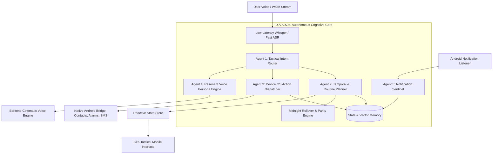

# D.A.K.S.H. (दक्ष)
### Decision & Knowledge Synthesizer for Human-operations
*The Autonomous Cognitive Personal Operating System*

---

## 1. Project Manifesto

**D.A.K.S.H.** is an advanced personal cognitive AI operating system inspired by the architectural intellect of Tony Stark's JARVIS/FRIDAY and rooted in the ancient Sanskrit principle of **दक्ष (Mastery, Vigilance, and Instantaneous Execution)**.

Unlike typical to-do list apps, voice assistants, or chatbots that rely on generic conversational wrappers, D.A.K.S.H. operates as an active **autonomous life copilot**. It observes device telemetry, intercepts and filters OS notifications in real time, manages complex temporal routine rhythms (daily walks, alternate-day wash/workout cycles, weekly cadences), and controls device hardware and system contacts through strict consent-based protocol authorization.

---

## 2. Design System: "Kite-Tactical" Architecture

D.A.K.S.H. deliberately abandons cliché AI design tropes—no cartoonish robot icons, no gimmicky glowing violet bubbles, and no low-density card grids.

Instead, the UI draws inspiration from **Zerodha Kite's** financial-grade minimalism combined with a **military tactical Heads-Up Display (HUD)**:

- **Default Theme:** **Tactical Light Mode** (High-contrast, paper-white/neutral parchment, ultra-fine 1px graphite borders, razor-sharp geometric typography).
- **Secondary Theme:** **Obsidian Dark Mode** (Deep OLED matte blacks `#0B0D11`, slate-grey sub-layers, subtle ice-cyan status indicators).
- **Typographic Precision:** Monospaced counters, timestamps, latency metrics, and clear data tables (`JetBrains Mono` / `Space Grotesk`).
- **Real-Time Dynamic Ledger:** Tasks, rolled-over backlogs, and notification streams are presented as clean execution tickets.

---

## 3. Cognitive Brain: Multi-Model Agent Architecture

D.A.K.S.H. decomposes intelligence into a decentralized multi-model pipeline:

### Specialized Agents

1. **Agent 1: Tactical Intent Router**  
   Sub-100ms classifier that parses incoming multimodal requests, distinguishing between informational queries, schedule operations, and high-privilege device commands.

2. **Agent 2: Temporal & Routine Planner**  
   Understands relative time, modulo-based alternate day intervals (e.g., hair wash cycles, gym splits), rolling deadlines, and multi-step reminders.

3. **Agent 3: Device OS Action Dispatcher**  
   Executes authorized hardware and system actions:
   - Modifying and renaming contacts (e.g., `"Rename Priya to Swimi"` via `ContactsContract`).
   - Triggering exact hardware alarms (`AlarmManager`).
   - Initiating direct phone calls and SMS alerts.

4. **Agent 4: Resonant Voice Persona Engine**  
   Generates terse, articulate, confident tactical briefings spoken in a rich, weighted baritone tone (Paul Bettany / Vision cadence) powered by low-latency neural synthesis.

5. **Agent 5: Notification Sentinel**  
   Passively listens to Android notifications, filters marketing noise, and elevates critical notifications (deliveries, bank OTPs, urgent messages) directly into the execution ledger.

---

## 4. Implementation Branches & System Hierarchy

The implementation is mapped into 6 distinct engineering branches:

* **`arch/core-engine`**: Python/Dart core orchestration runtime, event bus, and agent lifecycle coordinator.
* **`agent/tactical-router`**: Fast SLM router, prompt templates, structured JSON tool schemas.
* **`agent/temporal-matrix`**: Modulo alternate-day calculator, midnight rollover cron, cadence tracker.
* **`platform/android-sentinel`**: Android native Kotlin bridge, `NotificationListenerService`, `ContactsContract` manager, permissions protocol.
* **`voice/neural-acoustic`**: Streaming speech recognition, baritone TTS pipeline, live conversational loop.
* **`ui/kite-tactical`**: Flutter/Compose high-density light & dark HUD, real-time ticket ledger, voice spectrum meter.

---

## 5. Privacy & Sovereign Execution

D.A.K.S.H. handles sensitive personal data (contacts, SMS, notifications). Consequently:
- All telemetry and database stores run on **encrypted local SQLite / Room storage**.
- External LLM inference calls are sanitized of unnecessary PII.
- All high-privilege device mutations require explicit initial user protocol authorization.
- The project repository is designed to transition to a private sovereign repository.

---

*DAKSH: Built for execution. Designed for clarity.*
